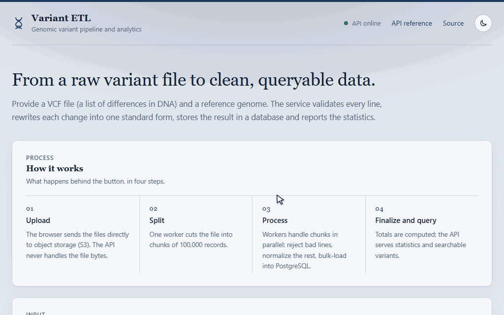
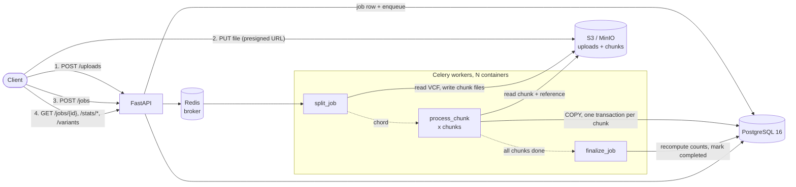
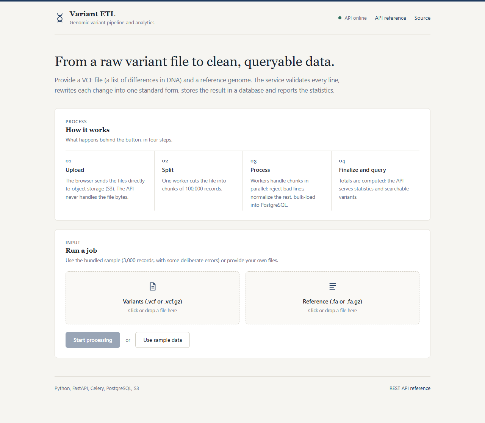
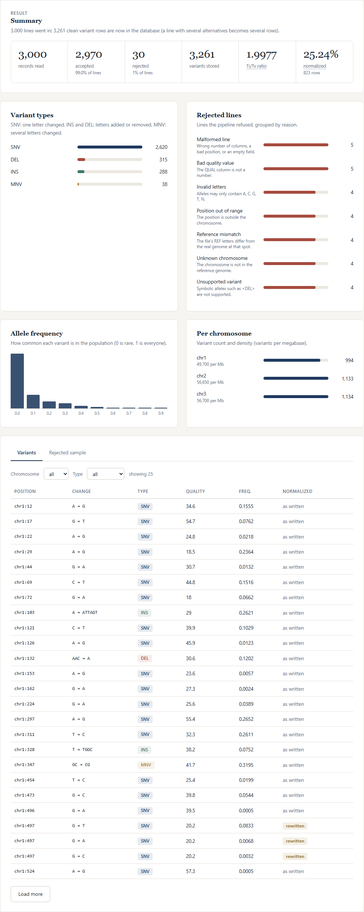
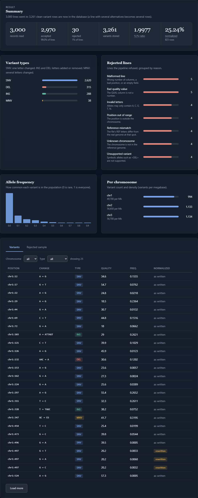

# Genomic Variant ETL Pipeline & Analytics Service

[](https://github.com/aleksandrahodzzik/genomic-etl-pipeline/actions/workflows/ci.yml)


A service for bioinformatics teams that turns a raw VCF file of genetic variants into clean, queryable data: it checks every record against the reference genome, rewrites it into the one standard form `bcftools norm` would produce, loads it into PostgreSQL in parallel chunks, and serves statistics and region queries through a REST API and a web UI.

**[Project site](https://aleksandrahodzzik.github.io/genomic-etl-pipeline/)**: the validation results, statistics and a searchable table of variants from a real run of the bundled sample, rebuilt by CI from the running stack on every push to `main`. It is a static snapshot; to process your own files, start the stack locally ([Quickstart](#quickstart-local)).



<sub>The web UI processing the `make demo` data: 200,000 records (0.5% deliberately broken) are uploaded, split into two 100k-record chunks and loaded; then the statistics, and the variant table filtered to deletions on chr2. Recorded headless with Playwright. Real speed except the running job, which is fast-forwarded as the badge says; the page's "Completed in … s" is the real time.</sub>

- **Scales out by adding containers**: 1 → 4 worker containers gave 1.7–1.9× the throughput on one laptop (30,567 → 57,241 records/s on 1M synthetic records, 27,758 → 49,565 on 1.09M ClinVar records). Chunks are independent, so N workers process N chunks at once.
- **Safe to retry**: chunk writes are idempotent, so a crashed or redelivered chunk never produces duplicate rows. [`test_crash_just_before_commit_leaves_nothing_and_the_retry_loads_exactly_once`](tests/integration/test_pipeline_direct.py) crashes a chunk after `COPY` has streamed every row but before `COMMIT`, then checks that nothing is visible and that the retry, and a forced re-run, load each row exactly once.
- **Checked against bcftools**: normalized output is compared record by record with `bcftools norm -m -any -f` in the test suite, and on 1,094,545 real ClinVar records both rewrite exactly the same rows (none: ClinVar ships normalized).

## Architecture



The client uploads the VCF and reference FASTA straight to S3-compatible storage with presigned URLs; a Celery chord splits the VCF into 100k-record chunks; independent worker containers validate and normalize them (equivalent to `bcftools norm -m -any -f`) and bulk-load the rows into an indexed PostgreSQL schema with `COPY`; FastAPI serves statistics and keyset-paginated queries. The API never touches file bytes, and workers never talk to the API: PostgreSQL holds all job state and Redis is only the task queue.

## Quickstart (local)

Prerequisites: [Docker](https://docs.docker.com/get-docker/) (with Compose v2), [uv](https://docs.astral.sh/uv/) and `make`.

```bash
git clone https://github.com/aleksandrahodzzik/genomic-etl-pipeline.git && cd genomic-etl-pipeline
make up      # postgres, redis, minio, migrations, api, worker; returns when everything is healthy
make demo    # generates 200k records, uploads them, runs a job, prints the stats
```

Then open the web UI at <http://localhost:8010/> (the interactive API docs are at <http://localhost:8010/docs>). Scale out with `docker compose up -d --scale worker=4`. Tear down with `make down` (this also deletes the volumes).

If port 8000 or 5432 is already taken by another project, move them: `API_PORT=8010 POSTGRES_PORT=5433 make up`, then use `http://localhost:8010/`. (`make demo`, the benchmark and the tests default to the standard ports: pass `--api`, or set `API_URL` and `DATABASE_URL`, to follow the change.)

Other targets: `make test`, `make lint`, `make data` (1M-record dataset), `make bench` (runs `make data`, then the benchmark that writes [`docs/BENCHMARKS.md`](docs/BENCHMARKS.md)), `make bench-clinvar` (the real-data benchmark that writes [`docs/BENCHMARKS_CLINVAR.md`](docs/BENCHMARKS_CLINVAR.md); downloads ~0.4 GB on first use), `make gif` (records `docs/images/demo.gif` from a running single-container image with Playwright), `make pages` (builds the [project site](#the-project-site) from a running stack and checks it in Chromium) and `make space-run` (the [single-container image](#the-single-container-image)).

> **Windows without `make`**: the Makefile is a thin wrapper, so run the commands it contains. For example, `docker compose up -d --build --wait` is `make up`; the recipes for `demo` and `bench` are two `uv run python scripts/...` lines.

### Web UI

The API also serves a small single-page UI (plain HTML and JavaScript, no build step). Click **Use sample data** or drop your own VCF and FASTA: the browser uploads straight to storage with presigned URLs, shows the job moving through split → process chunks → finalize, then the summary, variant types, reject reasons, allele-frequency histogram, per-chromosome density and a variant table filtered by chromosome, type and region, with keyset pagination. It uses only the public REST API described below.

A sample database is pre-loaded: the one-shot `seed` service in `docker-compose.yml` processes the bundled 3,000-record sample when the stack starts, and the page shows that result the first time it is opened (`GET /api/v1/demo` returns the job, or `null` if it was never seeded). Seeding is idempotent, so restarting is harmless; to reload it by hand run `docker compose run --rm seed`.

**Opening it from a phone on the same Wi-Fi.** The browser uploads files straight to MinIO, so the presigned URLs must point at an address the phone can reach, not `localhost`:

```powershell
# on the computer: find its LAN address (e.g. 192.168.1.20), then
$env:S3_PUBLIC_ENDPOINT_URL = "http://192.168.1.20:9000"
docker compose up -d --build --wait
# on the phone: http://192.168.1.20:8000/
```

Windows Firewall blocks incoming connections on networks marked *Public*. On a trusted home network, set the network to *Private* and allow the two ports from an administrator PowerShell (and remove the rule afterwards; MinIO uses the default `minioadmin` demo credentials, so do not leave it open on a shared network):

```powershell
New-NetFirewallRule -DisplayName "Variant ETL (phone)" -Direction Inbound -Protocol TCP -LocalPort 8000,9000 -Action Allow -Profile Private
Remove-NetFirewallRule -DisplayName "Variant ETL (phone)"   # when done
```





There is a light and a dark theme (the button in the header switches them; the choice is remembered in the browser).



## The project site

[`pages/`](pages/) is a one-page site in the style of the [Reflow template by 8B](https://8b.com/templates/reflow/) (MIT). [`scripts/export_pages.py`](scripts/export_pages.py) waits for the stack to process the bundled sample, then saves the API's own answers for that job (statistics, every variant row, every stored rejected line) next to the page, so every number on it is pipeline output rather than text typed into HTML. Its variant explorer filters the saved rows in the browser by the API's rules. [`scripts/pages_smoke.py`](scripts/pages_smoke.py) checks in Chromium that the explorer returns exactly the API's rows for the same filters, that the page loads with no errors, and that it fits a 360 px screen. The [Pages workflow](.github/workflows/pages.yml) runs both on every push and publishes from `main`; `make pages` does the same against a local stack.

## The single-container image

[`Dockerfile.space`](Dockerfile.space) runs PostgreSQL, Redis, MinIO, migrations, the API, two Celery workers, a janitor and nginx in **one container** as a non-root user under [supervisord](space/supervisord.conf), with only nginx's port 7860 reachable, so the whole service can run as a public demo on one free machine such as a Hugging Face Space ([`scripts/deploy_space.py`](scripts/deploy_space.py), `make space-deploy`). `make space-run` starts it locally at <http://localhost:7860/>.

- **Uploads through the one port: a reverse proxy, not a new upload path.** The API still hands out presigned URLs, signed for the container's public address; [nginx](space/nginx.conf) sends `PUT /variant-etl/…` (the bucket's path) to MinIO and everything else to the API, so the browser uploads exactly as it does with compose and the API still never handles file bytes. nginx shows MinIO the host the URL was signed for, because the signature covers the `Host` header.
- **Safety.** [`start.sh`](space/start.sh) generates new random credentials for PostgreSQL, Redis and MinIO on every boot (never the defaults), and all three listen on 127.0.0.1 only. Uploads are capped at 20 MB (nginx answers 413), at most 2 jobs run at a time (`POST /jobs` answers 429), and a janitor deletes jobs and files older than an hour, except the 3,000-record sample that is seeded at boot. None of this is on in the compose stack: the settings default to off.
- **Run 100k synthetic records.** A button that only the demo shows: 100,000 records made by `scripts/generate_data.py` when the image is built, uploaded as a fresh copy on each click and processed as four 25,000-record chunks (the demo sets `CHUNK_SIZE=25000` so the two workers have something to share).
- [`scripts/space_smoke.py`](scripts/space_smoke.py) checks a running image end to end through its one port (sample job, statistics, region query, an upload through the proxy, the synthetic job, the 20 MB cap); CI builds the image and runs it on every push.

## Example requests

The bundled demo does all of this; here it is by hand. The response bodies below are real output of `make demo`.

```bash
# 1. Ask for a presigned upload URL (repeat for the reference FASTA)
curl -s -X POST localhost:8000/api/v1/uploads -H 'content-type: application/json' \
     -d '{"filename": "sample.vcf"}'
# {"key": "uploads/9130…/sample.vcf", "upload_url": "http://localhost:9000/variant-etl/uploads/…?X-Amz-…",
#  "method": "PUT", "expires_in": 3600}

# 2. PUT the file straight to object storage
curl -s -X PUT --upload-file variants.vcf "<upload_url>"

# 3. Start a job (202; 200 with "deduplicated": true if the same inputs were already processed)
curl -s -X POST localhost:8000/api/v1/jobs -H 'content-type: application/json' \
     -d '{"vcf_key": "uploads/…/variants.vcf", "reference_key": "uploads/…/ref.fa"}'

# 4. Poll
curl -s localhost:8000/api/v1/jobs/$JOB
# {"status": "completed", "counts": {"total": 200000, "accepted": 199000, "rejected": 1000, "normalized": 54144},
#  "progress": {"chunks_total": 2, "chunks_done": 2, "chunks_failed": 0, "fraction": 1.0}, "duration_seconds": 6.55, …}

# 5. Analytics
curl -s localhost:8000/api/v1/jobs/$JOB/stats/summary
curl -s localhost:8000/api/v1/jobs/$JOB/stats/chromosomes
curl -s "localhost:8000/api/v1/jobs/$JOB/stats/af-histogram?bins=4"
# {"bins": [{"bin_start": 0.0, "bin_end": 0.25, "count": 182377}, {"bin_start": 0.25, "bin_end": 0.5, "count": 27588}, …]}
curl -s "localhost:8000/api/v1/jobs/$JOB/variants?chrom=chr1&start=1&end=50000&type=DEL&limit=2"
# {"items": [{"chrom": "chr1", "pos": 65, "ref": "TTAA", "alt": "T", "variant_type": "DEL", "was_normalized": false, …},
#            {"chrom": "chr1", "pos": 2186, "ref": "TG", "alt": "T", "was_normalized": true, …}],
#  "next_cursor": "WyJjaHIxIiwgMjE4NiwgMzIzNzU0Mzdd"}      # pass as ?cursor=… for the next page
curl -s "localhost:8000/api/v1/jobs/$JOB/rejected?limit=2"
# {"items": [{"line_no": 253, "reason": "unknown_contig", "raw_line": "chrUn_249\t7791\t.\tG\tA\t…"}, …], "next_after_line": 279, …}
```

`/stats/summary` reports variants by type, the transition/transversion ratio of SNVs, the share of normalized rows and rejected records by reason. Stats on a job that is still running carry `"partial": true`.

## Benchmarks

### Real data: ClinVar GRCh38

[ClinVar](https://www.ncbi.nlm.nih.gov/clinvar/) GRCh38 (release 2026-10-25, chromosomes 1, 2 and 17: 1,094,545 records, a quarter of the release) next to the synthetic 1M-record set, both measured on one laptop in the same session. Method, inputs with checksums and raw numbers: [`docs/BENCHMARKS_CLINVAR.md`](docs/BENCHMARKS_CLINVAR.md); reproduce with `make bench-clinvar`.

| | Synthetic, 1M records | ClinVar GRCh38, 1.09M records |
|---|---:|---:|
| Throughput, 1 worker container | 30,567 records/s (32.7 s) | 27,758 records/s (39.4 s) |
| Throughput, 4 worker containers | 57,241 records/s (17.5 s) | 49,565 records/s (22.1 s) |
| Rejected records | 5,000 (0.5%), broken on purpose | 312 (0.03%), all `ALT .` |
| Rows rewritten by normalization | 268,552 (24.7%) | 0, as `bcftools norm` agrees |
| Region query, 10 kb window, with index: median / p95 | 1.8 / 2.6 ms | 1.6 / 5.8 ms |
| Same query without the index: median | 103 ms | 64 ms |

The 312 rejected ClinVar records have no alternate allele: they are ClinVar's records about the reference allele itself (HGVS `g.N=`, "no change"), so there is nothing to store. ClinVar ships already normalized, and `bcftools norm` over the same records also splits and realigns nothing. The higher ClinVar p95 comes from clinical variants clustering in genes: its densest 10 kb window holds 6,741 rows, against at most 839 in the synthetic set. The laptop was short of memory during this run, so all times are probably a little pessimistic; the report explains why.

[`scripts/benchmark_clinvar.py`](scripts/benchmark_clinvar.py) downloads a pinned ClinVar release and the UCSC hg38 sequence of the chosen chromosomes, checks both against the MD5 sums their publishers post, and keeps the ClinVar records on those chromosomes. The default subset is chromosomes 1, 2 and 17, the three with the most ClinVar records: the whole GRCh38 reference (3.1 Gb) would be copied into and indexed by every worker container, and records on chromosomes missing from the reference would only measure `unknown_contig`. ClinVar and the synthetic set are measured in one session, alternating run by run, so drift on the machine hits both alike. The script also runs `bcftools norm -m -any -f` over the same ClinVar records as an independent check of normalization.

### Synthetic, 1M records

1M VCF records (5,000 deliberately invalid; 1,089,328 normalized rows), 10 chunks of 100k, AMD Ryzen 5 7535HS laptop, Docker Desktop with PostgreSQL, Redis, MinIO and the API on the same machine, so this measures the architecture on one host, not a cluster. Median of 3 runs after 1 warm-up. Full methodology, exact commands, `EXPLAIN` plans and raw numbers are in [`docs/BENCHMARKS.md`](docs/BENCHMARKS.md).

| Measurement | Result |
|---|---|
| 1 worker container | 36.8 s, 27,142 records/s |
| 2 worker containers | 22.6 s, 44,255 records/s (1.63x) |
| 4 worker containers | 21.2 s, 47,261 records/s (1.74x) |
| Region query (10 kb window), with `(job_id, chrom, pos)` index | median 2.09 ms, p95 3.02 ms |
| Same query without the index | median 63.78 ms, p95 100.76 ms (31x slower) |
| Keyset page (101 rows) from the middle of the job | 1.24 ms |
| Inserting 100k rows: `COPY` vs. SQLAlchemy ORM `add_all` | 0.45 s vs. 15.89 s |

The table is the latest run of `make bench` from a fresh clone; the same 1M records measured next to ClinVar above gave 30,567 / 57,241 records/s with 1 / 4 workers. The same benchmark run earlier on the same machine gave 33.7 s / 20.5 s / 17.5 s for 1 / 2 / 4 workers (1.93x at 4), a 28x index speed-up, and 0.33 s vs. 14.47 s for `COPY` vs. the ORM, so treat the ratios and ranges as the result, not the exact figures. Scaling is sub-linear on this machine because the workers share one CPU and one PostgreSQL instance with everything else; [`docs/BENCHMARKS.md`](docs/BENCHMARKS.md) lists both sessions side by side and says what was and was not isolated.

## How validation and normalization work

Input is VCF 4.2, sites only (the 8 fixed columns, with `AF` read from `INFO`), plain or gzip/BGZF; the reference is a FASTA indexed on the fly by [pyfaidx](https://github.com/mdshw5/pyfaidx). Chromosome names are matched through an alias map (`chr1` ↔ `1`, `MT` ↔ `chrM`). The parser is hand-written and streams line by line; there is no pysam in the application.

**Validation** assigns each rejected record exactly one reason, checked in this fixed order:

| order | reason | meaning |
|---:|---|---|
| 1 | `malformed_line` | wrong column count, non-integer `POS`, empty field, or an ALT identical to REF |
| 2 | `non_numeric_qual` | `QUAL` is neither `.` nor a finite number (`nan`/`inf` are rejected) |
| 3 | `unknown_contig` | contig is not in the reference |
| 4 | `pos_out_of_bounds` | `POS`, or `POS + len(REF) - 1`, falls outside the contig |
| 5 | `unsupported_symbolic` | `<DEL>`, breakends, `*` and similar ALTs |
| 6 | `invalid_allele_chars` | anything other than `A C G T N` in REF/ALT |
| 7 | `ref_mismatch` | REF does not equal the reference sequence at that position |

If any ALT of a multi-allelic record is bad, the whole record is rejected.

**Normalization** follows [Tan et al. 2015](https://doi.org/10.1093/bioinformatics/btv112) and is meant to equal `bcftools norm -m -any -f ref.fa`:

1. **Split** multi-allelic records into one row per ALT.
2. **Trim** the bases shared by REF and ALT on the right, then on the left, keeping at least one base.
3. **Left-align**: while REF and ALT end in the same base, drop it and move one base left, pulling that base from the reference to the front. At the start of a contig, pad on the right instead.

Example: take the reference `G CACACA G` (positions 1-8). Deleting the last `CA` of the repeat is written `ACA → A` at position 5. Left-alignment slides it to the repeat's left edge and gives `GCA → G` at position 1, the same row that a caller writing the deletion at the left edge produces, so the same event written two ways ends up as one row.

Row semantics worth knowing:
- Record counts (`total`, `accepted`, `rejected`) count VCF records; `variants` counts rows, which is larger whenever a multi-allelic record was split.
- `was_normalized` is true if the row differs from how it was written **or** came from a multi-allelic split.
- Variant type comes from the trimmed alleles (`SNV`, `MNV`, `INS`, `DEL`, `COMPLEX`); `is_transition` is set for SNVs only, and Ti/Tv ignores `N`.
- Rejected lines are stored as a bounded sample (10,000 per chunk by default); the per-reason counts are exact. `line_no` refers to the line in the original file.

## Design decisions

- **Presigned uploads.** Files go from the client to object storage without passing through the API, so API memory and request timeouts do not depend on file size (VCFs run to many GB). The API only issues a short-lived URL and later checks that the objects exist. Presigned URLs are signed for `S3_PUBLIC_ENDPOINT_URL`, because the endpoint the client reaches is not the one containers use.
- **Celery chord vs. one big task.** One task per file would make a failure at 95% cost the whole job, and cannot use more than one worker. The chunk is the unit of parallelism, of retry and of the database transaction. `split_job` builds the chord (`group(process_chunk) → finalize_job`) itself after it knows how many chunks there are. `process_chunk` *returns* a failure result for permanent errors instead of raising, so the chord body always runs and the job ends `failed` with the failing chunks listed, rather than hanging.
- **At-least-once delivery + idempotent writes.** Workers use `acks_late` and `reject_on_worker_lost`, so a killed worker's chunk is redelivered; transient infrastructure errors (S3 5xx, database connection errors) are retried with jittered exponential backoff. Redelivery is made harmless in the loader: in one transaction it takes an advisory lock on `(job, chunk)`, deletes whatever that chunk previously wrote, `COPY`s the new rows and writes a marker row. A chunk whose marker already says `done` is skipped. `finalize` recomputes the job totals from committed markers, so a job is `completed` only when every chunk is.
- **`COPY` vs. `executemany` vs. ORM.** For 100k rows into a bare table, `COPY` took 0.45 s, `executemany` 6.49 s, SQLAlchemy Core 7.83 s, the ORM 15.89 s ([benchmark section 4](docs/BENCHMARKS.md)). The pipeline uses psycopg 3's `COPY` for variants and rejected records; SQLAlchemy is used for the schema, migrations (Alembic) and the API queries.
- **Indexes stay on during load.** Dropping them before a single large load and rebuilding afterwards did not give a reliable win in the benchmark (36.8 s vs. 37.5 s in one session, 33.7 s vs. 29.1 s in another), and with chunks committing concurrently and results queryable as soon as a chunk lands, maintaining them is the simpler, always-correct choice. The trade-off is documented in the first migration.
- **Index shape.** `(job_id, chrom, pos)` serves region queries and keyset pagination (`(chrom, pos, id)` cursor, no `OFFSET`); `(job_id, variant_type)` serves the by-type stats. The roughly 30x difference above (28x and 31x in the two sessions) is measured with `EXPLAIN ANALYZE`, not guessed.
- **S3 abstraction and the MinIO situation.** All storage access goes through `storage/s3.py` (boto3), so anything S3-compatible works. MinIO's community edition no longer publishes container images, so compose pins a community-maintained fork, `pgsty/minio`, at a fixed tag; switching to another S3-compatible store, or to AWS S3, is a matter of environment variables.
- **A hand-written VCF parser instead of pysam.** The service needs 8 columns and streaming access, not the full htslib API. A small parser keeps the install pure-Python (no compiled htslib in the image), and every behaviour is covered by tests, including an oracle comparison with bcftools. The cost: only sites-only VCF is supported (see below).
- **Dedup by content.** A job's identity is a checksum over both inputs (ETag and size), so resubmitting the same files returns the existing job (HTTP 200). A *failed* job is deleted and recreated on resubmit.

## Testing

```bash
make test        # 193 tests; integration tests need `make up` first
make lint        # ruff check, ruff format --check, mypy
```

- **Unit**: parser, validation precedence, normalization edge cases (left-alignment, contig start, multi-allelic splits), gzip/BGZF handling, chunking (including `line_no` preservation).
- **bcftools oracle** (`tests/unit/test_oracle_bcftools.py`): the pipeline's output on a ~200 KB generated fixture is compared with `bcftools norm -m -any -f`, plus a guard test that proves the comparison fails for a normalizer that does not left-align. It uses `bcftools` from the PATH, or falls back to a pinned bcftools 1.21 container through Docker; only the tests use it. If neither is available the oracle tests are skipped, and CI installs bcftools so they always run there.
- **Ground truth**: `scripts/generate_data.py` is deterministic and writes `truth.json` computed from how records are *built* (counts per type and per reject reason, Ti/Tv), never from the pipeline, with injected invalid lines and unaligned indels in repeats. Tests assert the pipeline reproduces it.
- **Integration** (real PostgreSQL, Redis, MinIO and Celery workers from the compose stack): direct loader tests, the full HTTP flow, a forced mid-chunk failure that is retried with no duplicate rows afterwards, and the demo image's admission limit, synthetic-records endpoint and janitor. They skip when the stack is unreachable, unless `REQUIRE_INTEGRATION=1` (which CI sets).
- **CI** ([`ci.yml`](.github/workflows/ci.yml)): lint → unit + oracle → integration on the compose stack → Docker image build; in parallel with integration, the demo image is built and checked end to end by `scripts/space_smoke.py`. The [Pages workflow](.github/workflows/pages.yml) builds the project site from the compose stack and checks it with `scripts/pages_smoke.py`.

## Limitations and next steps

- **Sites only.** No `FORMAT`/sample/genotype columns: adding them means a `genotypes` table or a columnar side store, since that is where per-variant data multiplies by the number of samples.
- **Partition `variants` by contig** (or by job) once tables reach hundreds of millions of rows, so that queries and `DROP` of a job touch one partition; consider a **BRIN** index on `pos` for the append-ordered data.
- **Parquet + DuckDB** for the analytical endpoints (`summary`, histograms) would take the aggregate load off PostgreSQL, keeping it for point and region queries.
- **Reference handling.** The FASTA is downloaded once per worker container into a local cache and indexed there (atomically, with the `.fai` as the completion marker). A shared cache volume or a pre-built index would remove that per-container cost.
- **Single-host numbers.** All benchmarks ran on one laptop; I have not measured a multi-host deployment. Scaling past the single PostgreSQL instance is the first limit to expect.
- **No authentication** on the API: it is meant to sit behind a gateway; the demo credentials in `.env.example` and compose are throwaway local values. The single-container image is meant for a public demo, which is why it caps uploads and concurrent jobs and deletes everything after an hour.

## Project layout

```
src/variant_etl/
  api/        FastAPI app, routers (jobs, stats) and the single-page web UI (static/)
  pipeline/   VCF parser, validation, normalization, chunking, loader, Celery tasks
  storage/    S3 client wrapper, bucket initialization
  db/         SQLAlchemy models, sessions, analytics queries
  schemas/    Pydantic v2 request/response models
  demo.py     the pre-loaded sample and the demo image's synthetic dataset
  janitor.py  the demo image's clean-up loop
alembic/      migrations
space/        the single-container demo image: start-up, supervisord, nginx, Space card
pages/        the project site (GitHub Pages), rendered from a snapshot of a real run
scripts/      data generator, demo, benchmarks (synthetic, ClinVar), GIF recorder, demo image deploy
              and smoke test, Pages export and smoke test
tests/        unit, oracle, integration; tiny fixtures in tests/data
docs/         BENCHMARKS.md, BENCHMARKS_CLINVAR.md, INTERVIEW.md, images/
```

MIT licensed.
