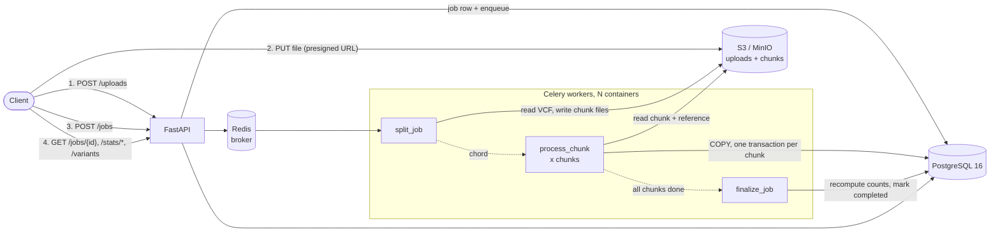
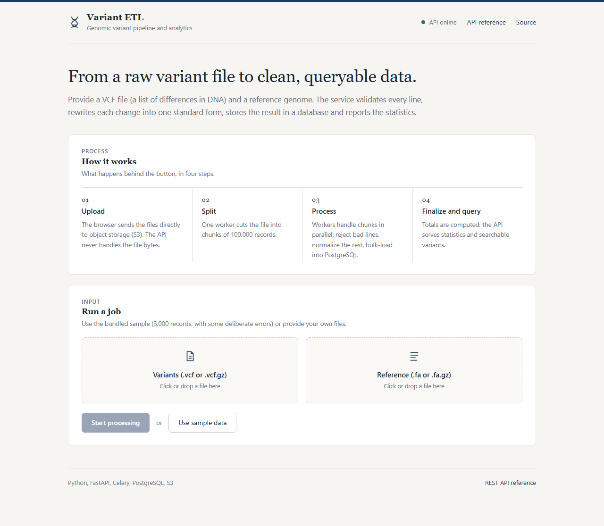
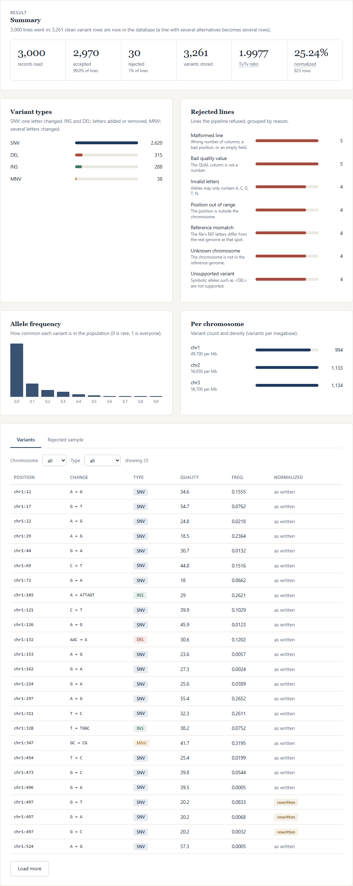
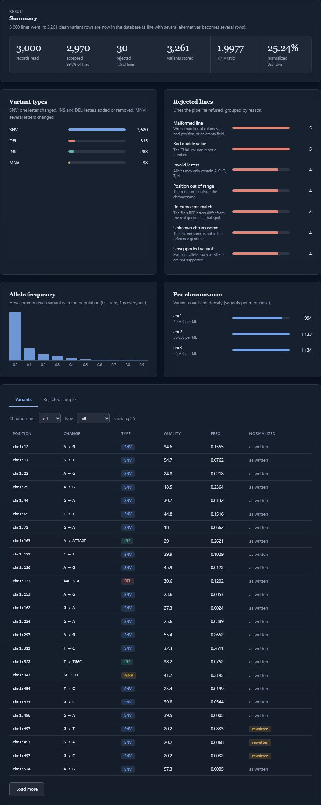

# Genomic Variant ETL Pipeline & Analytics Service

[](https://github.com/aleksandrahodzzik/genomic-etl-pipeline/actions/workflows/ci.yml)


An asynchronous ETL service for genomic variant data. You upload a VCF and a reference FASTA straight to S3-compatible storage; a Celery chord splits the VCF into 100k-record chunks, independent worker containers validate and normalize them (equivalent to `bcftools norm -m -any -f`), bulk-load the result into an indexed PostgreSQL schema with `COPY`, and a FastAPI service serves statistics and keyset-paginated queries over it.

- **Scales out by adding containers**: `docker compose up --scale worker=4`. On the 1M-record benchmark below, going from 1 to 4 workers cut the wall time by a factor of 1.7–1.9 on one laptop (two independent sessions).
- **Safe to retry**: chunk writes are idempotent, so a crashed or redelivered chunk never produces duplicate rows (there is an integration test that forces exactly that).
- **Checked against an independent implementation**: normalized output is compared record by record with `bcftools norm`, and a generator with a built-in ground truth checks the whole pipeline.

## Architecture



The API never touches file bytes, and workers never talk to the API: PostgreSQL holds all job state and Redis is only the task queue.

## Quickstart

Prerequisites: [Docker](https://docs.docker.com/get-docker/) (with Compose v2), [uv](https://docs.astral.sh/uv/) and `make`.

```bash
git clone https://github.com/aleksandrahodzzik/genomic-etl-pipeline.git && cd genomic-etl-pipeline
make up      # postgres, redis, minio, migrations, api, worker; returns when everything is healthy
make demo    # generates 200k records, uploads them, runs a job, prints the stats
```

Then open the web UI at <http://localhost:8000/> (the interactive API docs are at <http://localhost:8000/docs>). Scale out with `docker compose up -d --scale worker=4`. Tear down with `make down` (this also deletes the volumes).

If port 8000 or 5432 is already taken by another project, move them: `API_PORT=8010 POSTGRES_PORT=5433 make up`, then use `http://localhost:8010/`. (`make demo`, the benchmark and the tests default to the standard ports: pass `--api`, or set `API_URL` and `DATABASE_URL`, to follow the change.)

### Web UI

The API also serves a small single-page UI (plain HTML and JavaScript, no build step). Click **Use sample data** or drop your own VCF and FASTA: the browser uploads straight to storage with presigned URLs, shows the job moving through split → process chunks → finalize, then the summary, variant types, reject reasons, allele-frequency histogram, per-chromosome density and a filterable, paginated variant table. It uses only the public REST API described below.

A sample database is pre-loaded: the one-shot `seed` service in `docker-compose.yml` processes the bundled 3,000-record sample when the stack starts, and the page shows that result the first time it is opened (`GET /api/v1/demo` returns the job, or `null` if it was never seeded). Seeding is idempotent, so restarting is harmless; to reload it by hand run `docker compose run --rm seed`.

**Opening it from a phone on the same Wi-Fi.** The browser uploads files straight to MinIO, so the presigned URLs must point at an address the phone can reach, not `localhost`:

```powershell
# on the computer: find its LAN address (e.g. 192.168.1.20), then
$env:S3_PUBLIC_ENDPOINT_URL = "http://192.168.1.20:9000"
docker compose up -d --build --wait
# on the phone: http://192.168.1.20:8000/
```

Windows Firewall blocks incoming connections on networks marked *Public*. On a trusted home network, set the network to *Private* and allow the two ports from an administrator PowerShell (and remove the rule afterwards; MinIO uses the default `minioadmin` demo credentials, so do not leave it open on a shared network):

```powershell
New-NetFirewallRule -DisplayName "Variant ETL (phone)" -Direction Inbound -Protocol TCP -LocalPort 8000,9000 -Action Allow -Profile Private
Remove-NetFirewallRule -DisplayName "Variant ETL (phone)"   # when done
```





There is a light and a dark theme (the button in the header switches them; the choice is remembered in the browser).



Other targets: `make test`, `make lint`, `make data` (1M-record dataset), `make bench` (runs `make data`, then the benchmark that writes [`docs/BENCHMARKS.md`](docs/BENCHMARKS.md)).

> **Windows without `make`**: the Makefile is a thin wrapper, so run the commands it contains. For example, `docker compose up -d --build --wait` is `make up`; the recipes for `demo` and `bench` are two `uv run python scripts/...` lines.

## Example requests

The bundled demo does all of this; here it is by hand. The response bodies below are real output of `make demo`.

```bash
# 1. Ask for a presigned upload URL (repeat for the reference FASTA)
curl -s -X POST localhost:8000/api/v1/uploads -H 'content-type: application/json' \
     -d '{"filename": "sample.vcf"}'
# {"key": "uploads/9130…/sample.vcf", "upload_url": "http://localhost:9000/variant-etl/uploads/…?X-Amz-…",
#  "method": "PUT", "expires_in": 3600}

# 2. PUT the file straight to object storage
curl -s -X PUT --upload-file variants.vcf "<upload_url>"

# 3. Start a job (202; 200 with "deduplicated": true if the same inputs were already processed)
curl -s -X POST localhost:8000/api/v1/jobs -H 'content-type: application/json' \
     -d '{"vcf_key": "uploads/…/variants.vcf", "reference_key": "uploads/…/ref.fa"}'

# 4. Poll
curl -s localhost:8000/api/v1/jobs/$JOB
# {"status": "completed", "counts": {"total": 200000, "accepted": 199000, "rejected": 1000, "normalized": 54144},
#  "progress": {"chunks_total": 2, "chunks_done": 2, "chunks_failed": 0, "fraction": 1.0}, "duration_seconds": 6.55, …}

# 5. Analytics
curl -s localhost:8000/api/v1/jobs/$JOB/stats/summary
curl -s localhost:8000/api/v1/jobs/$JOB/stats/chromosomes
curl -s "localhost:8000/api/v1/jobs/$JOB/stats/af-histogram?bins=4"
# {"bins": [{"bin_start": 0.0, "bin_end": 0.25, "count": 182377}, {"bin_start": 0.25, "bin_end": 0.5, "count": 27588}, …]}
curl -s "localhost:8000/api/v1/jobs/$JOB/variants?chrom=chr1&start=1&end=50000&type=DEL&limit=2"
# {"items": [{"chrom": "chr1", "pos": 65, "ref": "TTAA", "alt": "T", "variant_type": "DEL", "was_normalized": false, …},
#            {"chrom": "chr1", "pos": 2186, "ref": "TG", "alt": "T", "was_normalized": true, …}],
#  "next_cursor": "WyJjaHIxIiwgMjE4NiwgMzIzNzU0Mzdd"}      # pass as ?cursor=… for the next page
curl -s "localhost:8000/api/v1/jobs/$JOB/rejected?limit=2"
# {"items": [{"line_no": 253, "reason": "unknown_contig", "raw_line": "chrUn_249\t7791\t.\tG\tA\t…"}, …], "next_after_line": 279, …}
```

`/stats/summary` reports variants by type, the transition/transversion ratio of SNVs, the share of normalized rows and rejected records by reason. Stats on a job that is still running carry `"partial": true`.

## How validation and normalization work

Input is VCF 4.2, sites only (the 8 fixed columns, with `AF` read from `INFO`), plain or gzip/BGZF; the reference is a FASTA indexed on the fly by [pyfaidx](https://github.com/mdshw5/pyfaidx). Chromosome names are matched through an alias map (`chr1` ↔ `1`, `MT` ↔ `chrM`). The parser is hand-written and streams line by line; there is no pysam in the application.

**Validation** assigns each rejected record exactly one reason, checked in this fixed order:

| order | reason | meaning |
|---:|---|---|
| 1 | `malformed_line` | wrong column count, non-integer `POS`, empty field, or an ALT identical to REF |
| 2 | `non_numeric_qual` | `QUAL` is neither `.` nor a finite number (`nan`/`inf` are rejected) |
| 3 | `unknown_contig` | contig is not in the reference |
| 4 | `pos_out_of_bounds` | `POS`, or `POS + len(REF) - 1`, falls outside the contig |
| 5 | `unsupported_symbolic` | `<DEL>`, breakends, `*` and similar ALTs |
| 6 | `invalid_allele_chars` | anything other than `A C G T N` in REF/ALT |
| 7 | `ref_mismatch` | REF does not equal the reference sequence at that position |

If any ALT of a multi-allelic record is bad, the whole record is rejected.

**Normalization** follows [Tan et al. 2015](https://doi.org/10.1093/bioinformatics/btv112) and is meant to equal `bcftools norm -m -any -f ref.fa`:

1. **Split** multi-allelic records into one row per ALT.
2. **Trim** the bases shared by REF and ALT on the right, then on the left, keeping at least one base.
3. **Left-align**: while REF and ALT end in the same base, drop it and move one base left, pulling that base from the reference to the front. At the start of a contig, pad on the right instead.

Example: take the reference `G CACACA G` (positions 1-8). Deleting the last `CA` of the repeat is written `ACA → A` at position 5. Left-alignment slides it to the repeat's left edge and gives `GCA → G` at position 1, the same row that a caller writing the deletion at the left edge produces, so the same event written two ways ends up as one row.

Row semantics worth knowing:
- Record counts (`total`, `accepted`, `rejected`) count VCF records; `variants` counts rows, which is larger whenever a multi-allelic record was split.
- `was_normalized` is true if the row differs from how it was written **or** came from a multi-allelic split.
- Variant type comes from the trimmed alleles (`SNV`, `MNV`, `INS`, `DEL`, `COMPLEX`); `is_transition` is set for SNVs only, and Ti/Tv ignores `N`.
- Rejected lines are stored as a bounded sample (10,000 per chunk by default); the per-reason counts are exact. `line_no` refers to the line in the original file.

## Benchmarks

1M VCF records (5,000 deliberately invalid; 1,089,328 normalized rows), 10 chunks of 100k, AMD Ryzen 5 7535HS laptop, Docker Desktop with PostgreSQL, Redis, MinIO and the API on the same machine, so this measures the architecture on one host, not a cluster. Median of 3 runs after 1 warm-up. Full methodology, exact commands, `EXPLAIN` plans and raw numbers are in [`docs/BENCHMARKS.md`](docs/BENCHMARKS.md).

| Measurement | Result |
|---|---|
| 1 worker container | 36.8 s, 27,142 records/s |
| 2 worker containers | 22.6 s, 44,255 records/s (1.63x) |
| 4 worker containers | 21.2 s, 47,261 records/s (1.74x) |
| Region query (10 kb window), with `(job_id, chrom, pos)` index | median 2.09 ms, p95 3.02 ms |
| Same query without the index | median 63.78 ms, p95 100.76 ms (31x slower) |
| Keyset page (101 rows) from the middle of the job | 1.24 ms |
| Inserting 100k rows: `COPY` vs. SQLAlchemy ORM `add_all` | 0.45 s vs. 15.89 s |

The table is the latest run (`make bench` from a fresh clone). The same benchmark run earlier on the same machine gave 33.7 s / 20.5 s / 17.5 s for 1 / 2 / 4 workers (1.93x at 4), a 28x index speed-up, and 0.33 s vs. 14.47 s for `COPY` vs. the ORM, so treat the ratios and ranges as the result, not the exact figures. Scaling is sub-linear on this machine because the workers share one CPU and one PostgreSQL instance with everything else; [`docs/BENCHMARKS.md`](docs/BENCHMARKS.md) lists both sessions side by side and says what was and was not isolated.

## Design decisions

- **Presigned uploads.** Files go from the client to object storage without passing through the API, so API memory and request timeouts do not depend on file size (VCFs run to many GB). The API only issues a short-lived URL and later checks that the objects exist. Presigned URLs are signed for `S3_PUBLIC_ENDPOINT_URL`, because the endpoint the client reaches is not the one containers use.
- **Celery chord vs. one big task.** One task per file would make a failure at 95% cost the whole job, and cannot use more than one worker. The chunk is the unit of parallelism, of retry and of the database transaction. `split_job` builds the chord (`group(process_chunk) → finalize_job`) itself after it knows how many chunks there are. `process_chunk` *returns* a failure result for permanent errors instead of raising, so the chord body always runs and the job ends `failed` with the failing chunks listed, rather than hanging.
- **At-least-once delivery + idempotent writes.** Workers use `acks_late` and `reject_on_worker_lost`, so a killed worker's chunk is redelivered; transient infrastructure errors (S3 5xx, database connection errors) are retried with jittered exponential backoff. Redelivery is made harmless in the loader: in one transaction it takes an advisory lock on `(job, chunk)`, deletes whatever that chunk previously wrote, `COPY`s the new rows and writes a marker row. A chunk whose marker already says `done` is skipped. `finalize` recomputes the job totals from committed markers, so a job is `completed` only when every chunk is.
- **`COPY` vs. `executemany` vs. ORM.** For 100k rows into a bare table, `COPY` took 0.45 s, `executemany` 6.49 s, SQLAlchemy Core 7.83 s, the ORM 15.89 s ([benchmark section 4](docs/BENCHMARKS.md)). The pipeline uses psycopg 3's `COPY` for variants and rejected records; SQLAlchemy is used for the schema, migrations (Alembic) and the API queries.
- **Indexes stay on during load.** Dropping them before a single large load and rebuilding afterwards did not give a reliable win in the benchmark (36.8 s vs. 37.5 s in one session, 33.7 s vs. 29.1 s in another), and with chunks committing concurrently and results queryable as soon as a chunk lands, maintaining them is the simpler, always-correct choice. The trade-off is documented in the first migration.
- **Index shape.** `(job_id, chrom, pos)` serves region queries and keyset pagination (`(chrom, pos, id)` cursor, no `OFFSET`); `(job_id, variant_type)` serves the by-type stats. The roughly 30x difference above (28x and 31x in the two sessions) is measured with `EXPLAIN ANALYZE`, not guessed.
- **S3 abstraction and the MinIO situation.** All storage access goes through `storage/s3.py` (boto3), so anything S3-compatible works. MinIO's community edition no longer publishes container images, so compose pins a community-maintained fork, `pgsty/minio`, at a fixed tag; switching to another S3-compatible store, or to AWS S3, is a matter of environment variables.
- **A hand-written VCF parser instead of pysam.** The service needs 8 columns and streaming access, not the full htslib API. A small parser keeps the install pure-Python (no compiled htslib in the image), and every behaviour is covered by tests, including an oracle comparison with bcftools. The cost: only sites-only VCF is supported (see below).
- **Dedup by content.** A job's identity is a checksum over both inputs (ETag and size), so resubmitting the same files returns the existing job (HTTP 200). A *failed* job is deleted and recreated on resubmit.

## Testing

```bash
make test        # 175 tests; integration tests need `make up` first
make lint        # ruff check, ruff format --check, mypy
```

- **Unit**: parser, validation precedence, normalization edge cases (left-alignment, contig start, multi-allelic splits), gzip/BGZF handling, chunking (including `line_no` preservation).
- **bcftools oracle** (`tests/unit/test_oracle_bcftools.py`): the pipeline's output on a ~200 KB generated fixture is compared with `bcftools norm -m -any -f`, plus a guard test that proves the comparison fails for a normalizer that does not left-align. It uses `bcftools` from the PATH, or falls back to a pinned bcftools 1.21 container through Docker; only the tests use it. If neither is available the oracle tests are skipped, and CI installs bcftools so they always run there.
- **Ground truth**: `scripts/generate_data.py` is deterministic and writes `truth.json` computed from how records are *built* (counts per type and per reject reason, Ti/Tv), never from the pipeline, with injected invalid lines and unaligned indels in repeats. Tests assert the pipeline reproduces it.
- **Integration** (real PostgreSQL, Redis, MinIO and Celery workers from the compose stack): direct loader tests, the full HTTP flow, and a forced mid-chunk failure that is retried with no duplicate rows afterwards. They skip when the stack is unreachable, unless `REQUIRE_INTEGRATION=1` (which CI sets).
- **CI** ([`ci.yml`](.github/workflows/ci.yml)): lint → unit + oracle → integration on the compose stack → Docker image build.

## Limitations and next steps

- **Sites only.** No `FORMAT`/sample/genotype columns: adding them means a `genotypes` table or a columnar side store, since that is where per-variant data multiplies by the number of samples.
- **Partition `variants` by contig** (or by job) once tables reach hundreds of millions of rows, so that queries and `DROP` of a job touch one partition; consider a **BRIN** index on `pos` for the append-ordered data.
- **Parquet + DuckDB** for the analytical endpoints (`summary`, histograms) would take the aggregate load off PostgreSQL, keeping it for point and region queries.
- **Reference handling.** The FASTA is downloaded once per worker container into a local cache and indexed there (atomically, with the `.fai` as the completion marker). A shared cache volume or a pre-built index would remove that per-container cost.
- **Single-host numbers.** All benchmarks ran on one laptop; I have not measured a multi-host deployment. Scaling past the single PostgreSQL instance is the first limit to expect.
- **No authentication** on the API: it is meant to sit behind a gateway; the demo credentials in `.env.example` and compose are throwaway local values.

## Project layout

```
src/variant_etl/
  api/        FastAPI app, routers (jobs, stats) and the single-page web UI (static/)
  pipeline/   VCF parser, validation, normalization, chunking, loader, Celery tasks
  storage/    S3 client wrapper, bucket initialization
  db/         SQLAlchemy models, sessions, analytics queries
  schemas/    Pydantic v2 request/response models
alembic/      migrations
scripts/      data generator, demo, benchmark
tests/        unit, oracle, integration; tiny fixtures in tests/data
docs/         BENCHMARKS.md, INTERVIEW.md
```

MIT licensed.
